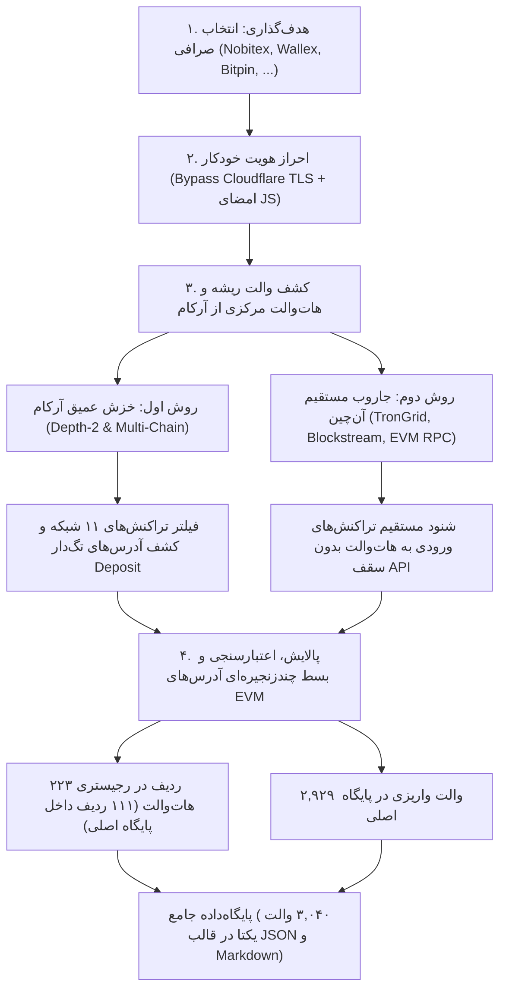
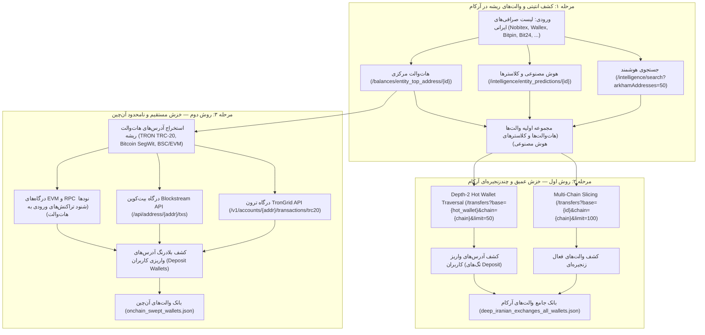
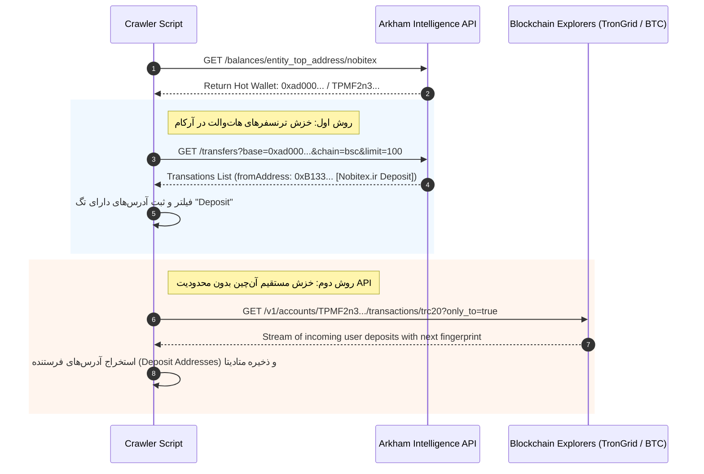

# arkm crawler & Iranian Exchanges Intelligence Suite

ابزار جامع خزش، مهندسی معکوس و استخراج **لیست ولت‌ها و آدرس‌های واریزی صرافی‌های ایرانی** از دیتابیس **Arkham Intelligence** و رهگیری مستقیم آن‌چین (On-Chain).

---

## 🗺️ نمودار ساده نحوه کار کراولر (Simple Methodology Workflow)

این دیاگرام ساده، مسیر گام‌به‌گام استخراج و تولید دیتابیس ۳,۰۴۰ والت را نشان می‌دهد:



---

## 🏗 معماری فنی و تفصیلی استخراج (Technical Architecture)

برای دور زدن محدودیت‌های سقف تعداد در پلن‌های معمولی آرکام (محدودیت `offset + limit <= 100` و مسدود بودن `timeLte`)، پروژه از یک **معماری دومرحله‌ای هیبریدی (Arkham Depth-2 + On-Chain Gateway)** استفاده می‌کند:



---

## 🔄 نمودار توالی خزش لایه دوم (Depth-2 Traversal Sequence)

نحوه استخراج آدرس‌های واریزی یک‌بارمصرف کاربران از طریق تراکنش‌های تجمیعی هات‌والت صرافی:



---

## 📂 ساختار فایل‌های پروژه

| فایل | توضیح |
| :--- | :--- |
| `run.sh` | **اسکریپت هوشمند سراسری (پیشنهادی):** مدیریت خودکار ورود مرورگر روی هاست + راه‌اندازی بی‌دردسر داکر |
| `scheduler.py` | **سرویس دائم ۲۴ ساعته با جیتر:** اجرای خودکار روزانه با بازه تصادفی برای کشف والت‌های جدید |
| `run_pipeline.py` | **پایپ‌لاین جامع پایتون:** اجرای زنجیره‌ای تمام مراحل (خزش آرکام + خزش آن‌چین + تجمیع نهایی) |
| `extract_hot_wallets_and_aggregate.py` | **استخراج و تجمیع هات‌والت‌ها:** تحلیل همگرایی تراکنش‌ها، بسط چندزنجیره‌ای و تجمیع نهایی |
| `deep_arkm_crawler.py` | **روش اول:** خزش پیشرفته چندزنجیره‌ای (Multi-Chain) و لایه دوم (Depth-2) در API آرکام |
| `onchain_wallet_sweeper.py` | **روش دوم:** جاروبگر مستقیم آن‌چین متصل به هات‌والت‌های ریشه (TronGrid + Blockstream + EVM JSON-RPC) |
| `extract_all_iranian_wallets.py` | اسکریپت پایه اسکن ۴۳ صرافی ایرانی در آرکام |
| `api_generator.py` | کلاینت بازپخش مستقل با دور زدن امضای JS و مدیریت احراز هویت / لاگین خودکار مرورگر |
| `arkm_capture.py` | ضبط ترافیک مرورگر کروم و استخراج نشست/کوکی‌ها |
| `Dockerfile` & `docker-compose.yml` | فایل‌های کانتینرسازی و استقرار ایزوله در محیط داکر |
| `storage_state.template.json` | الگوی تمیز ذخیره نشست و کوکی‌های احراز هویت |
| `targets.txt` | فهرست ۴۱ صرافی و بستر معاملاتی ایرانی |
| `api_output/iranian_exchanges_hot_wallets.json` | **فهرست رسمی ۲۲۳ هات‌والت تاییدشده** صرافی‌های ایرانی به تفکیک شبکه و نقش |
| `api_output/iranian_exchanges_hot_wallets.md` | گزارش تفصیلی تحلیلی هات‌والت‌ها به تفکیک صرافی |
| `api_output/deep_iranian_exchanges_all_wallets.json` | پایگاه‌داده جامع تجمیعی با **۳,۰۴۰ والت یکتا** (۱۱۱ هات‌والت داخل پایگاه + ۲,۹۲۹ واریزی) |
| `api_output/onchain_swept_wallets.json` | خروجی والت‌های واریزی کاربران کشف‌شده از آن‌چین |
| `api_output/deep_iranian_wallets/` | پوشه گزارش‌های تفکیکی هر صرافی (Nobitex, Wallex, Bitpin, ...) |

---

## 🚀 راهنمای اجرا

### ⚡ روش اول: اجرای تک‌دستوری هوشمند با `run.sh` (پیشنهادی‌ترین روش)

این اسکریپت تمام مراحل را به صورت خودکار مدیریت می‌کند:
1. ابتدا بررسی می‌کند که آیا نشست معتبر در `storage_state.json` وجود دارد یا خیر.
2. اگر نشست وجود نداشته باشد، **مرورگر کروم را روی مانیتور شما باز می‌کند** تا لاگین کرده و کپچا را حل کنید.
3. بلافاصله پس از ورود، نشست ذخیره شده و **کانتینر داکر به صورت خودکار اجرا می‌شود** و خزش را بدون نیاز به مرورگر انجام می‌دهد.

```bash
# اعطای دسترسی اجرا (یک بار)
chmod +x run.sh

# ۱. اجرای یک‌باره کامل (پیش‌فرض):
./run.sh

# ۲. اجرای دائم به صورت سرویس پس‌زمینه (حلقه ۲۴ ساعته با جیتر هوشمند):
./run.sh --daemon

# ۳. نصب خودکار به عنوان سرویس لینوکس (Linux Systemd Service):
./run.sh --install-service
```

گزینه‌های دیگر `run.sh`:
```bash
./run.sh --status-service     # مشاهده وضعیت سرویس systemd
./run.sh --uninstall-service  # حذف سرویس لینوکس
./run.sh --login              # اجبار به ورود مجدد و دریافت کوکی‌های تازه
./run.sh --skip-arkm          # رد شدن از آرکام و فقط اجرای آن‌چین و تجمیع دیتابیس
./run.sh --skip-onchain       # رد شدن از بخش آن‌چین
```

---

### روش دوم: اجرای دستی مستقیم با پایتون (Python Native)

#### ۱. پیش‌نیازها و نصب وابستگی‌ها
```bash
python3 -m venv .venv
source .venv/bin/activate
pip install -r requirements.txt
playwright install chrome
```

#### ۲. ورود به حساب کاربری (یک‌بار برای همیشه)
با دستور زیر مرورگر کروم باز می‌شود؛ ایمیل/پسورد خود در آرکام را وارد کرده و در صورت وجود کپچا آن را حل کنید:
```bash
python3 api_generator.py login
```
> **نکته:** بلافاصله پس از ورود، کوکی‌های تاییدشده (`arkham_session` و `cf_clearance`) به صورت خودکار در فایل `storage_state.json` ذخیره می‌شوند و برای ماه‌ها نیازی به لاگین مجدد نخواهد بود.

#### ۳. اجرای کامل پایپ‌لاین خزش (All-in-One)
```bash
python3 run_pipeline.py
```

---

### روش سوم: اجرا با دستورات استاندارد داکر (Docker Compose)

اگر لاگین را قبلاً انجام داده‌اید یا فایل `storage_state.json` موجود است:
```bash
docker compose up --build
```
تمام دیتای خروجی به صورت خودکار در پوشه `api_output` سیستم شما ذخیره خواهد شد.

---

### اجرای دستی استیج‌ها به‌صورت مجزا:

#### ۱. اجرای خزش عمیق آرکام (روش اول - Multi-Chain & Depth-2)
این اسکریپت ۱۱ شبکه بلاک‌چین را به همراه ترنسفرهای لایه دوم هات‌والت‌های صرافی‌های ایرانی اسکن می‌کند:
```bash
python deep_arkm_crawler.py
```
گزینه‌های سفارشی‌سازی:
```bash
python deep_arkm_crawler.py --delay 0.3 --depth2-limit 50 --transfers-per-chain 100
# فقط روی شبکه‌های اصلی:
python deep_arkm_crawler.py --chains tron bsc ethereum bitcoin
```

### ۲. اجرای جاروبگر آن‌چین (روش دوم - On-Chain Sweeper)
این اسکریپت با اتصال به TronGrid، Blockstream و RPCهای عمومی EVM، آدرس‌های واریزی کاربران که به هات‌والت‌های صرافی‌ها پول واریز کرده‌اند را استخراج می‌کند:
```bash
python onchain_wallet_sweeper.py
```
گزینه‌های سفارشی‌سازی:
```bash
python onchain_wallet_sweeper.py --pages 10 --limit 50
```

### ۳. استخراج نهایی هات‌والت‌ها و تجمیع پایگاه‌داده (Hot Wallet Aggregator)
این اسکریپت تحلیل همگرایی را انجام داده، تمامی هات‌والت‌های قطعی را تفکیک و رجیستری ۲۲۳ هات‌والت رسمی را می‌سازد:
```bash
python extract_hot_wallets_and_aggregate.py
```

---

## 📡 اندپوینت‌های کشف‌شده آرکام برای استخراج والت‌ها

در جریان مهندسی معکوس کدهای فرانت‌اند آرکام، اندپوینت‌های کلیدی زیر استخراج و پیاده‌سازی شدند:

1. **کشف کلاسترهای هوش مصنوعی و موجودی:**
   ```http
   GET https://api.arkm.com/intelligence/entity_predictions/{entity_id}
   ```
2. **کشف هات‌والت اصلی و ریشه:**
   ```http
   GET https://api.arkm.com/balances/entity_top_address/{entity_id}
   ```
3. **جستجوی آدرس‌های برچسب‌خورده (سقف ۵۰):**
   ```http
   GET https://api.arkm.com/intelligence/search?query={exchange}&arkhamAddresses=50
   ```
4. **خزش تراکنش‌ها با تفکیک زنجیره:**
   ```http
   GET https://api.arkm.com/transfers?base={entity_or_address}&chain={chain}&limit=100&flow=all
   ```
5. **بررسی حضور چندشبکه‌ای آدرس‌های EVM:**
   ```http
   GET https://api.arkm.com/intelligence/address/{address}/all
   ```
6. **تفکیک موجودی زنجیره‌ای:**
   ```http
   GET https://api.arkm.com/balances/v2/entity/{entity_id}/chains
   ```

---

## 📊 نتایج استخراج ذخیره‌شده (۳,۰۴۰ والت یکتا، ۲۲۳ ردیف رجیستری هات‌والت)

ستون والت‌ها تعداد ردیف‌های پایگاه اصلی است. ستون هات‌والت تعداد ردیف‌های رجیستری است و بسط میان‌زنجیره‌ای EVM را هم شامل می‌شود، بنابراین می‌تواند از تعداد ردیف‌های همان صرافی در پایگاه اصلی بیشتر باشد. از ۳,۰۴۰ ردیف پایگاه، ۱۱۱ هات‌والت و ۲,۹۲۹ واریزی هستند.

| صرافی | شناسه در آرکام | والت‌های پایگاه | ردیف رجیستری هات‌والت | شبکه‌ها در پایگاه اصلی |
| :--- | :--- | :---: | :---: | :--- |
| **نوبیتکس (Nobitex)** | `nobitex` | **۱,۱۷۱** | **۹۰** | EVM (598), TRON (352), BSC (52), Ethereum (45), Polygon (44), Arbitrum (43), Bitcoin (35), Dogecoin (1), Optimism (1) |
| **بیت ۲۴ (Bit24)** | `bit24` | **۱,۱۳۸** | **۱** | TRON (1138) |
| **بیت‌پین (Bitpin)** | `bitpin` | **۲۸۳** | **۴۴** | BSC (67), Ethereum (66), Arbitrum (63), Polygon (63), EVM (16), TRON (8) |
| **آبان‌تتر (AbanTether)** | `abantether` | **۲۱۵** | **۸** | BSC (84), Arbitrum (44), Ethereum (43), Polygon (43), EVM (1) |
| **والکس (Wallex)** | `wallex-ir` | **۱۴۶** | **۹** | Ethereum (91), TRON (40), EVM (13), Arbitrum (2) |
| **رمزینکس (Ramzinex)** | `ramzinex` | **۳۷** | **۴۰** | Ethereum (11), Polygon (7), BSC (6), Arbitrum (6), TRON (4), Dogecoin (2), EVM (1) |
| **فرهاد اکسچنج (Farhad)** | `farhad-exchange` | **۲۱** | **۸** | EVM (19), Ethereum (1), BSC (1) |
| **اکسکوینو (Excoino)** | `excoino` | **۲۰** | **۱۵** | Optimism (4), Arbitrum (4), Ethereum (3), Polygon (3), BSC (2), Avalanche (2), EVM (1), Base (1) |
| **ارزپایا (ArzPaya)** | `arzpaya-com` | **۹** | **۸** | EVM (5), Ethereum (1), BSC (1), Arbitrum (1), Polygon (1) |
| **مجموع** | - | **۳,۰۴۰** | **۲۲۳** | **۱۱ زنجیره بلاک‌چین** |

---

## 🔐 امضای درخواست‌های آرکام و Cloudflare

آرکام هر درخواست API را با استفاده از کلید درون باندل اعتبارسنجی می‌کند:
```text
X-Timestamp = Unix Seconds
X-Payload   = sha256(KEY + ":" + sha256(pathname + ":" + ts + ":" + KEY))
KEY         = NEXT_PUBLIC_WEBAPP_CLIENT_KEY
```
کلاینت پایتون پروژه (`api_generator.py`) این امضا را برای تک‌تک درخواست‌ها به‌صورت بلادرنگ تولید کرده و با استفاده از کتابخانه `curl_cffi` با اثر انگشت مرورگر واقعی کروم (`impersonate="chrome"`) فایروال Cloudflare را مدیریت می‌کند.
